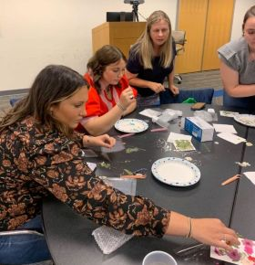
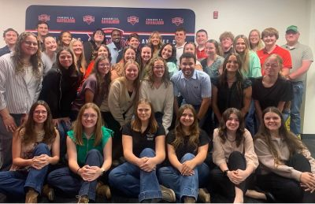

On Thursday, Oct. 8, KCC's Agri-Hort Technology program welcomed 36 college students from across the state participating in the Section 10 FCAE STAR Bus Trip.

The event is organized by Facilitating Coordination in Agricultural Education, and is designed to inspire future agricultural educators through hands-on learning experiences.

{: width="280" height="290"}

At KCC, the students participated in a floral design workshop, creating decorative dried floral design nightlights and ornaments.

The workshop activity can be adapted as a creative activity in their own future classrooms, said Katelynn Ohrt, director of the agri-hort program at KCC.

“The visit highlighted the value of agricultural education and gave aspiring agricultural educators new ideas to bring agriculture to life for their students,” Ohrt continued.

{: width="400" height="259"}

KCC provides hands-on learning, internships, industry connections, and community engagement so students can prepare for careers in agriculture and horticulture.

Class topics include [greenhouse operations](https://catalog.kcc.edu/agri-hort/hort-1173 "greenhouse operations"){: target="_blank" rel="noopener"}; [turf management](https://catalog.kcc.edu/agri-hort/hort-1234 "turf management"){: target="_blank" rel="noopener"}; [cultivating plants](https://catalog.kcc.edu/agri-hort/hort-1023 "cultivating plants"){: target="_blank" rel="noopener"}, [fruits and vegetables](https://catalog.kcc.edu/agri-hort/hort-1323 "fruits and vegetables"){: target="_blank" rel="noopener"}; [soil science](https://catalog.kcc.edu/agri-hort/agrc-1624 "soil science"){: target="_blank" rel="noopener"}; [landscape design](https://catalog.kcc.edu/agri-hort/hort-1154 "landscape design"){: target="_blank" rel="noopener"}; [animal science](https://catalog.kcc.edu/agri-hort/agrc-1704 "animal science"){: target="_blank" rel="noopener"}; [pest management](https://catalog.kcc.edu/agri-hort/aght-1013 "pest management"){: target="_blank" rel="noopener"}; and [farmsteading](https://catalog.kcc.edu/agri-hort/aght-1103 "farmsteading"){: target="_blank" rel="noopener"}.

KCC offers [seven options in agriculture and horticulture](https://catalog.kcc.edu/degrees?program=1862&amp;type=All "Agriculture and horticulture program list"){: target="_blank" rel="noopener"}, with short-term certificates, advanced certificates and two associate degrees. The associate degrees are an [Agriculture](https://catalog.kcc.edu/agri-hort/associate-of-science/agriculture-sample-transfer-plan) transfer option and an [Agri-Hort Technology](https://catalog.kcc.edu/agri-hort/associate-of-applied-science/agri-hort-technology) Associate of Applied Science.

To learn more about the program, contact Ohrt at [kohrt@kcc.edu](mailto:kohrt@kcc.edu "kohrt@kcc.edu"){: target="_blank" rel="noopener"} or 815-802-8859.

&nbsp;

&nbsp;