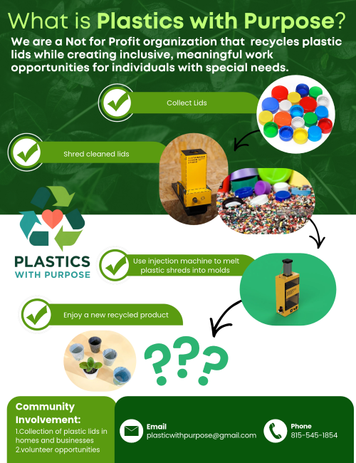

Calling all Cavaliers! We need your help with a campus-wide collection effort!

KCC is partnering with Plastics with Purpose, a nonprofit organization that recycles plastic lids while creating inclusive, meaningful work opportunities for individuals with special needs. We are asking the entire KCC community, including students, faculty, and staff, to join us in collecting plastic lids and supporting this meaningful initiative.

{: width="500" height="650"}
{: .center-this-text}

**How can you help?**

* Save your plastic lids! Instead of throwing them away, start collecting them to donate to a great cause.
* Spread the word! Encourage your coworkers, students, friends, and family to participate.
* Drop off your collection! **A collection bin is located on the 3rd floor by the Food Pantry**. Bring your clean plastic lids and add them to our campus collection!

**Why does it matter?**

The collected lids are cleaned, shredded, and transformed into new products using specialized recycling equipment. This initiative not only reduces plastic waste but also provides meaningful opportunities for individuals with special needs. Every lid counts, and every contribution makes a difference!

Let's come together as a campus community to support sustainability, inclusion, and meaningful opportunities for others.

Thank you for helping KCC make a positive impact!