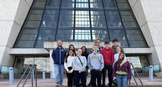
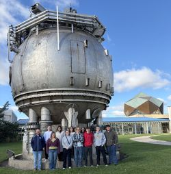

{: width="273" height="147"}

The KCC STEM club went to FermiLab national accelerator laboratory in Batavia on Nov. 6.

The visit included a tour of the 6,800 acre campus, complete with bison and nesting osprey. Students and staff toured the main facility which focuses on using particle accelerators to study neutrinos and muons and ended the day with a lecture on the study of dark matter from one of the physicists on site.

"Overall, it was a really interesting trip for the STEM club!" said club adviser Liz Scott.

{: width="250" height="254"}